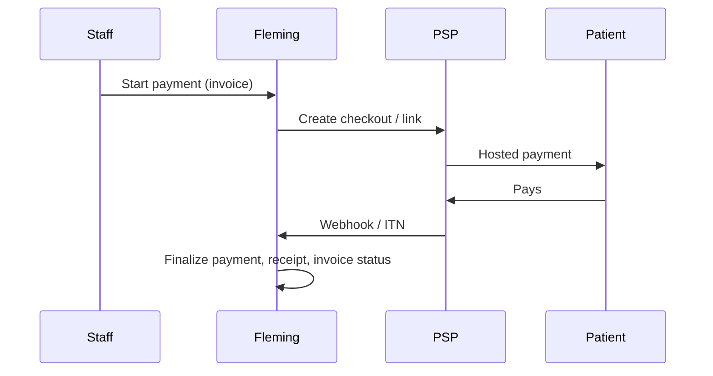

# Payment integrations

Fleming orchestrates patient-balance collection; each practice remains merchant of record. Hosted providers must keep card data outside Fleming.

## Current provider status

- Polar: checkout and webhook flow available when configured.
- Stitch: EFT/payment-link flow available when configured.
- Cash, manual EFT, and medical-aid settlement: operator-recorded flows.
- Yoco: disabled.
- PayFast: disabled.
- Payflex: disabled.

Yoco, PayFast, and Payflex are fail-closed in both checkout and webhook routes. This repository does not contain enough certified provider specification to safely verify signatures and finalize those payments. Their UI controls show unavailable status, and the API returns `PAYMENT_PROVIDER_NOT_CERTIFIED`.

## Core paths

- Checkout/payment command: `POST /api/billing/invoices/[id]/payments`
- Provider orchestration: `lib/billing/payments.ts`
- Provider adapters: `lib/billing/providers/`
- Provider status reason: `lib/billing/providers/availability.ts`
- Reconciliation import/match: `app/api/billing/reconciliation/`
- Operator reconciliation UI: `app/components/admin/billing-work-queue.tsx`

`practice_payments` uses a per-practice idempotency key. Provider success finalization calls the transactional `finalize_billing_payment_success` database function, which locks payment and invoice rows and recomputes the invoice balance from succeeded payments.

Claim invoices are guarded against more than one non-void invoice per claim. Repeated API calls return the existing invoice.

## Reconciliation

The Billing → Reconciliation view accepts CSV rows:

```text
external_ref,amount_cents,fees_cents
reference-123,12500,350
```

Operators can import, auto-match, dispute, or unmatch settlement lines using the existing reconciliation APIs. Amounts are integer cents.

## Required migration

Apply migrations in timestamp order, including:

- `20260418120000_billing_invoices_payments.sql`
- `20260425120000_billing_automation_claim_appointment_providers.sql`
- `20260501000000_revenue_cycle_extensions.sql`
- `20260721115955_revenue_claim_integrity.sql`

## External gaps

Before enabling another provider, obtain and test:

1. Checkout/order API specification and tenant credential model.
2. Exact raw-body signature algorithm, timestamp/replay policy, and key rotation.
3. Server-to-server payment-status verification.
4. Stable event and payment identifiers for idempotency.
5. Refund and chargeback semantics.
6. Provider sandbox certification fixtures.

Never enable a provider based only on the presence of API keys.
# Payment integrations (Fleming billing)

This document describes how Fleming integrates with payment service providers (PSPs) for **private / patient-responsibility** balances. It assumes an **aggregator model**: each **practice** is the merchant of record at the PSP; funds settle to the practice’s account. Fleming orchestrates checkout creation, patient communications, and reconciliation. Fleming does **not** hold patient funds.

For claim submission and scheme adjudication, see [MEDIKREDIT_INTEGRATION.md](/MEDIKREDIT_INTEGRATION.md) in the repo root.

---

## 1. Architecture

| Layer | Responsibility |
|--------|------------------|
| **Practice PSP account** | Merchant ID, API keys, webhooks pointing at Fleming (or practice-owned proxy). |
| **Fleming app** | Creates checkouts / payment links, stores `practice_payments` rows, issues receipts on success, updates `practice_invoices`. |
| **`payment_provider_events`** | Idempotent webhook audit (Polar/Stitch today; extend for Yoco/PayFast/Payflex). |
| **Patient** | Hosted checkout or redirect; no raw card data in Fleming (PCI scope minimisation). |



---

## 2. Unified provider adapter (code)

Contract: [`lib/billing/providers/adapter.ts`](../lib/billing/providers/adapter.ts).

Implementations:

| Provider | Module | Status |
|----------|--------|--------|
| Polar | `lib/billing/providers/polar.ts` | Live + webhook |
| Stitch | `lib/billing/providers/stitch.ts` | Live + webhook |
| Yoco | `lib/billing/providers/yoco.ts` | Dry-run / stub; extend with REST |
| PayFast | `lib/billing/providers/payfast.ts` | Dry-run unless `PAYFAST_LIVE=1` + merchant id |
| Payflex | `lib/billing/providers/payflex.ts` | Dry-run / stub |

Orchestration: [`lib/billing/payments.ts`](../lib/billing/payments.ts) (`initCardCheckout`, `initStitchEft`, `initYocoCheckout`, `initPayfastCheckout`, `initPayflexCheckout`).

Patient-facing entry: [`app/api/billing/invoices/[id]/payments/route.ts`](../app/api/billing/invoices/[id]/payments/route.ts).

---

## 3. Provider notes

### Polar

- **Auth**: `POLAR_SH_ACCESS_TOKEN`, `POLAR_SH_PRODUCT_PRICE_ID`.
- **Webhook**: `POLAR_SH_WEBHOOK_SECRET`, `POST /api/billing/polar/webhook`.
- **Dev**: `POLAR_SH_DRY_RUN=1` or omit token.

### Stitch

- **Auth**: `STITCH_CLIENT_ID`, `STITCH_CLIENT_SECRET`.
- **Webhook**: `POST /api/billing/stitch/webhook` (configure secret per Stitch dashboard).
- **Dev**: `STITCH_DRY_RUN=1`.

### Yoco

- **Intent**: Card and terminal estate common in ZA practices.
- **Env**: `YOCO_SECRET_KEY`, `YOCO_PUBLISHABLE_KEY` (future per-practice storage); `YOCO_DRY_RUN=1` for stub URLs.
- **Webhook**: Stub `POST /api/billing/yoco/webhook` — replace with signature verification and `finalizePendingPaymentSuccess` when live.

### PayFast

- **Flow**: Hosted redirect + **ITN** (Instant Transaction Notification) server-to-server.
- **Env**: `PAYFAST_MERCHANT_ID`, `PASSPHRASE`, etc. **Live** only when `PAYFAST_LIVE=1` and signed form POST is implemented; otherwise dry-run URL.
- **Webhook**: Stub `POST /api/billing/payfast/webhook` — should parse `application/x-www-form-urlencoded` ITN body, verify signature, match `m_payment_id` / invoice metadata, dedupe with `payment_provider_events`.

### Payflex

- **Env**: `PAYFLEX_API_KEY`; `PAYFLEX_DRY_RUN=1` for stub.
- **Webhook**: Stub `POST /api/billing/payflex/webhook`.

---

## 4. Database

- **`practice_payments.provider`** allows: `cash`, `polar`, `stitch`, `yoco`, `payfast`, `payflex`, `eft_manual`, `medical_aid`, `write_off` (see migration `20260425120000_billing_automation_claim_appointment_providers.sql`).
- **Platform fees**: Optional split between Fleming and practice should be implemented at the PSP (e.g. PayFast split, Stitch fees configuration), not by holding balances in Fleming.

---

## 5. Compliance (high level)

- **PCI**: Prefer hosted fields / redirect only; never log card numbers.
- **POPIA**: Patient phone/email used for SMS and voice follow-ups; store purpose in billing audit / follow-up tables.
- **FSP**: Aggregator model (practice as merchant) avoids Fleming acting as deposit-taker for clinical fees; confirm with legal counsel for your jurisdictions and product positioning.

---

## 6. Rollout order (recommended)

1. **Yoco** — highest in-person and online adoption in ZA SME medical.
2. **PayFast** — strong hosted page + ITN pattern; easy practice onboarding.
3. **Payflex** — BNPL positioning for larger patient balances.

Polar and Stitch remain default **online** rails in the product until regional connectors are live per practice.

---

## 7. Automation & follow-up

- **Settings**: `practice_billing_automation_settings` (`GET`/`PUT` `/api/billing/automation-settings`).
- **Shortfall SMS**: After MediKredit partial approval, optional auto issue + SMS via [`lib/billing/invoice-delivery.ts`](../lib/billing/invoice-delivery.ts).
- **Voice**: `POST /api/billing/invoices/[id]/voice-follow-up` uses Vapi + `practice_channels` voice configuration; logs `practice_billing_follow_ups`.

---

## 8. Required Supabase migrations (billing)

Apply migrations **in timestamp order** via the CLI when possible. The automation migration (`20260425120000_…`) **idempotently creates** minimal `practice_invoices` / `practice_payments` if they are missing (e.g. SQL Editor ran only that file). You should still apply **`20260418120000_billing_invoices_payments.sql`** for the full billing stack: RLS, receipts, credit notes, sequences, `next_billing_number`, cash drawer FK, `patient_access_tokens` invoice purpose, and the `billing-documents` bucket.

| Order | Migration | Purpose |
|-------|-----------|---------|
| 1 | `supabase/migrations/20260418120000_billing_invoices_payments.sql` | Full billing core (invoices, payments, RLS, sequences, storage, …) |
| 2 | `supabase/migrations/20260425120000_billing_automation_claim_appointment_providers.sql` | `practice_claims.appointment_id`, automation settings, `practice_billing_follow_ups`, extended `practice_payments.provider` |

From the repo root, with the Supabase CLI logged in:

```bash
supabase db push
# or
supabase migration up
```

Until the automation migration is applied, `createInvoiceFromClaim` may retry without certain columns if the DB is behind; keep the schema aligned by running all pending migrations.

**SQL Editor:** Prefer running `20260418120000` in full first, then `20260425120000`. If you only run the automation file, re-run `20260418120000` afterward so RLS and the rest of billing match production.
